<div align="center">

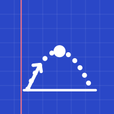

# UTC Preparation

**Подготовка к вступительному экзамену по физике и математике — теория, формулы, анимации и тесты в одном приложении**


### [▶ Открыть приложение в браузере](https://usmonovich.github.io/utc-preparation/)

<sub>Работает на компьютере, Android и iPhone. На телефоне: «Поделиться» → «На экран „Домой“» — и приложение откроется как обычное.</sub>

</div>

---

## О проекте

UTC Preparation — мобильное приложение для абитуриентов. На стартовом экране выбираешь предмет, и у каждого предмета — своя учебная база, свой прогресс, тесты и избранное.

| | Физика | Математика |
|---|---|---|
| Основа | собственные конспекты лекций | порядок тем сборника тестовых заданий для абитуриентов (2 части) |
| Темы | 164 | 131 (все пункты оглавления) |
| Формулы | 735 — с расшифровкой обозначений и единиц СИ | 302 — с пояснением «когда применять» |
| Разобранные примеры | 39 | 393 — «дано → найти → метод → шаги → проверка» |
| Вопросы и задачи | 1141 | 1048 — с пошаговыми решениями |
| Анимированные рисунки | 139 | 36 |

## Скриншоты

<p align="center">
  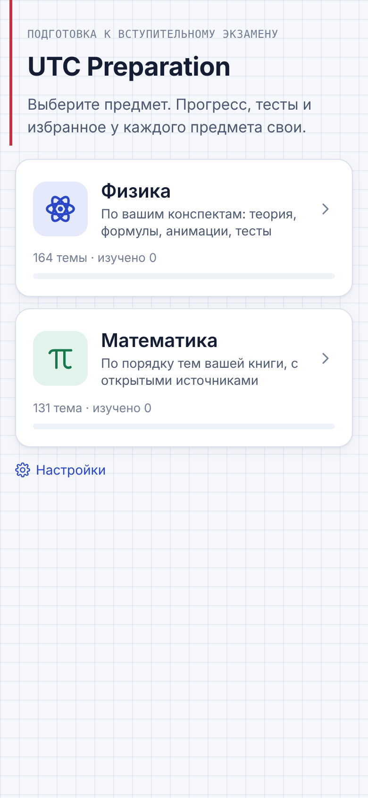
  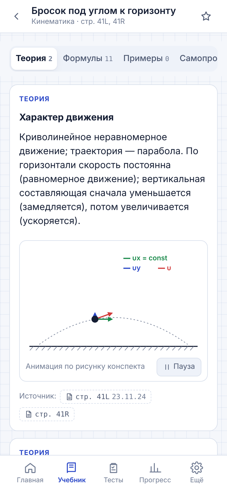
  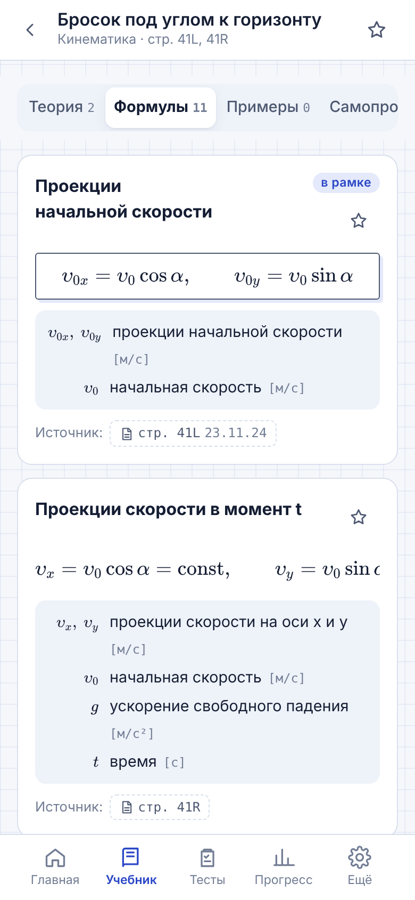
  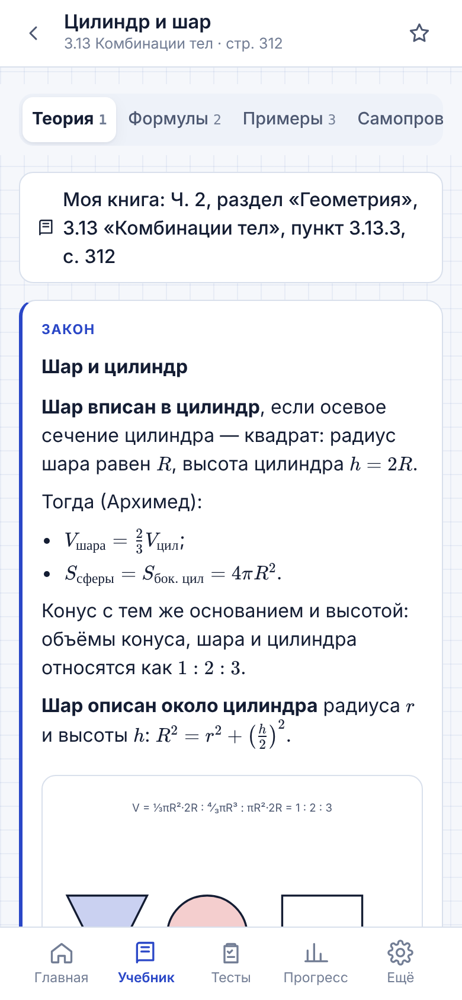
  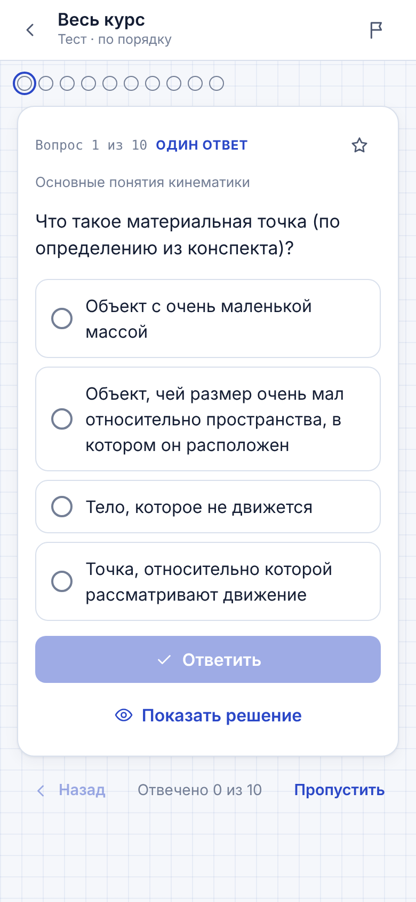
</p>

<details>
<summary>Тёмная тема</summary>
<p align="center">
  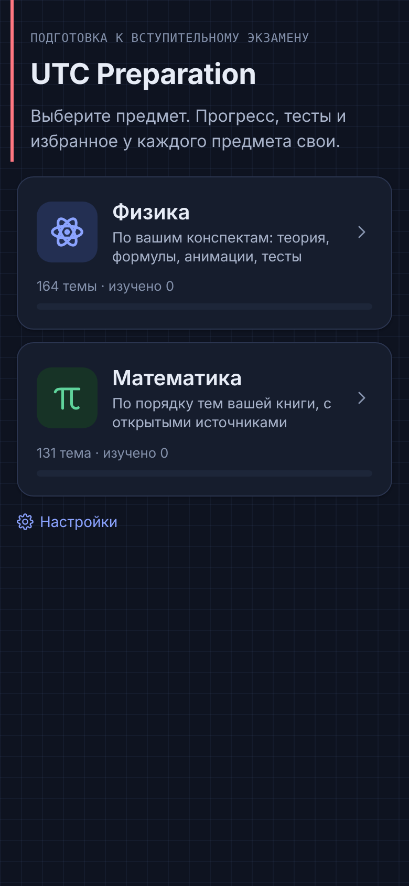
  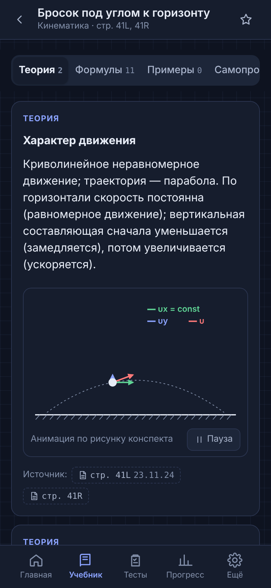
  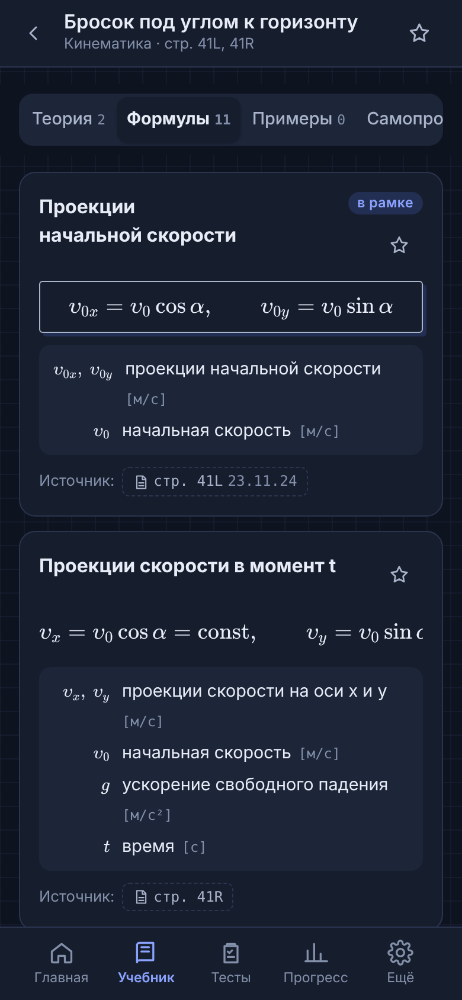
  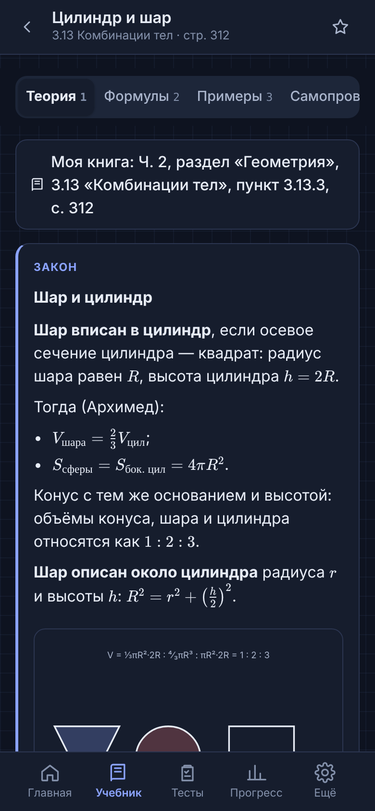
  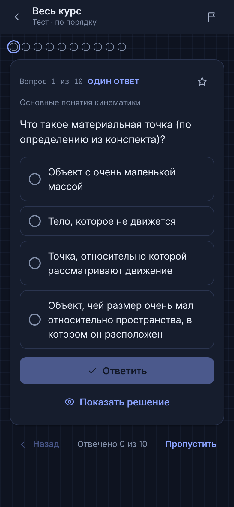
</p>
</details>

## Возможности

- 📚 **Учебник** — раздел → подраздел → тема: теория, формулы, разобранные примеры, самопроверка.
- 🧮 **Формулы на KaTeX** — каждая с обозначениями, единицами и условиями применения; поиск по формулам и темам.
- 🎞️ **Анимированные рисунки** — движение тел, поля, цепи, оптика, графики функций, тела вращения (чистый SVG, работают без интернета).
- ✅ **Тесты** — по теме, подразделу или всему курсу; по порядку или вперемешку; один/несколько ответов, число, сопоставление, последовательность.
- 💡 **Подсказка и вторая попытка** — после ошибки подсказка, затем полный разбор с подстановкой и ответом.
- 🔁 **Повторение ошибок**, карточки, экзамен с таймером, избранное.
- 📈 **Прогресс** — по темам, история попыток, слабые места.
- 🌗 Светлая и тёмная тема, крупный шрифт, работа без интернета, без рекламы и трекеров.
- 🛡️ **Только проверенный материал** — в сборку для студентов попадают лишь записи, утверждённые владельцем; замечания к конспектам видны только в админ-панели.

## Технологии

| Слой | Что используется |
|---|---|
| Интерфейс | React 19 + TypeScript, собственная дизайн-система на CSS-переменных |
| Формулы | KaTeX, проверка рендера каждой формулы при сборке |
| Сборка | esbuild (`tools/build.mjs`) |
| Мобильная версия | Capacitor 8 (Android target SDK 36, iOS) |
| Учебная база | YAML → `tools/build-content.ts` → JSON-пакет с проверками (ссылки на страницы, ответы, дубли, KaTeX) |
| Синхронизация (необязательно) | Supabase: Postgres + RLS |
| Тесты | node:test (unit), Playwright (e2e), Postgres 16 (миграции и RLS) |

## Быстрый старт

Нужен Node.js 22+.

```bash
npm install
npm run content:build     # проверить и собрать учебные базы физики и математики
npm run build             # веб-версия в dist/
npm run serve             # http://localhost:4173
```

Сборка для магазинов и сайта — только утверждённые материалы, без админ-панели:

```bash
npm run release:pack
npm run build:release
```

### Android (Windows)

Установите Android Studio (Otter 2025.2.1 или новее) с Android SDK 36 и запустите:

```bat
tools\android\build-android.cmd -Mode DebugApk   :: APK для проверки на телефоне
tools\android\build-android.cmd                  :: подписанный AAB для Google Play
```

Скрипт сам находит JDK 21, создаёт проект Android, иконки и заставку, ставит номер версии и создаёт ключ подписи. Подробно — в [docs/05-release-guide.md](docs/05-release-guide.md).

## Тесты

```bash
npm run test:unit         # 221 тест: логика тестов и ответов, физика, математика (перебором и численно), целостность базы
npm run test:e2e          # 25 сценариев в Chromium (запустите перед этим npm run serve)
npm run test:e2e:cloud    # 8 сценариев сохранения в режиме опубликованной страницы
npm run test:db           # миграции и RLS на Postgres 16
```

## Структура

```
content/
  src/*.yaml            физика: темы, теория, формулы, примеры, вопросы (по подразделам)
  math/src/*.yaml       математика: план курса по книге и наполненные темы
  student/physics.yaml  тексты для студентов без замечаний к конспекту
  figures/, math/figures/   анимированные SVG-рисунки
  release/              снимок решений проверки и пакеты только из утверждённых записей
src/
  domain/               логика без интерфейса: тесты, проверка ответов, подсказки, статистика, поиск
  data/                 хранилище, синхронизация, действия администратора
  ui/, admin/           экраны приложения и админ-панели
tools/                  сборка учебной базы и приложения, рисунки, скрипт Android
tests/                  unit, e2e, БД
docs/                   техническое задание, отчёты, инструкции
store/                  значки, тексты для магазинов, политика конфиденциальности
```

## Документация

| Документ | О чём |
|---|---|
| [01 — техническое задание](docs/01-specification.md) | архитектура, стек, схема БД, экраны |
| [03 — отчёт импорта конспектов](docs/03-import-report.md) | что извлечено из каждого конспекта |
| [04 — отчёт о тестировании](docs/04-test-report.md) | что и как проверено |
| [05 — сборка и публикация](docs/05-release-guide.md) | Android, iOS, Google Play, App Store |
| [06 — сервер](docs/06-backend-setup.md) | Supabase, роли, резервные копии |
| [07 — новые материалы](docs/07-adding-materials.md) | как добавлять темы и вопросы |
| [08 — известные ограничения](docs/08-known-limitations.md) | честный список того, что не сделано |
| [09 — математика по книге](docs/09-math-import-report.md) | состояние каждой из 131 темы и источники |

## Материалы и авторские права

- **Физика** составлена по личным конспектам автора. Фотографии страниц конспектов **не публикуются** в этом репозитории (в `content/pages/` — только список файлов); приложение показывает вместо фото пояснение. Пробелы конспектов дополнены материалами из открытых источников — у каждой такой записи есть ссылки.
- **Математика** идёт в порядке тем книги «Математика. Сборник тестовых заданий для абитуриентов», но задания книги **не копируются**: теория, примеры и задачи составлены по открытым учебникам (OpenStax, материалы университетов), у каждой темы указаны источники и дата проверки.
- Админ-панель есть только в личной версии владельца, вход по PIN; хеш PIN хранится вне репозитория (`.admin-pin`).

## Статус

Версия 1.0. [Веб-версия](https://usmonovich.github.io/utc-preparation/) собирается автоматически при каждом обновлении ветки `main` (GitHub Actions → GitHub Pages); сборка для Android проверена на телефоне. В Google Play и App Store приложение пока **не опубликовано**. Синхронизация через Supabase написана, но на живом сервере не проверена.

## Автор

[@usmonovich](https://github.com/usmonovich)

Лицензия не указана: код и материалы можно смотреть, но использование и распространение — только с разрешения автора.
